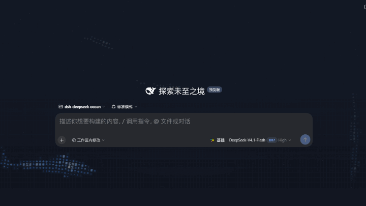
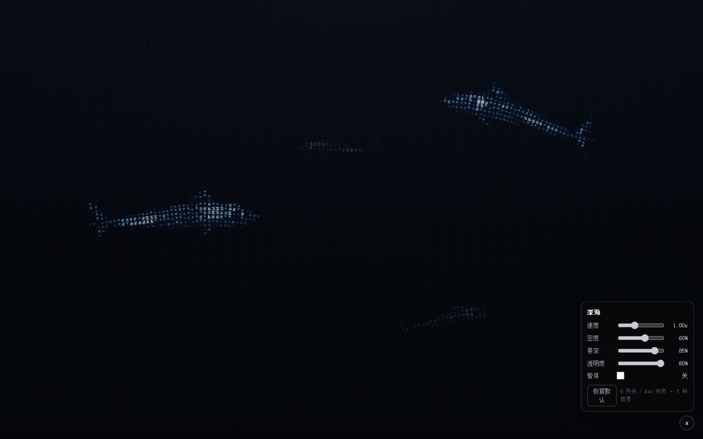

# Deep Ocean · 深海

全屏、沉浸式的 **ASCII 绘画风**鲨鱼背景插件，用于 [DeepSeek Harness](https://github.com/deepseek-ai/deepseek-harness) 桌面端。

鱼不是贴图，而是由字符网格实时"画"出来的：每个格子按光照选择 ASCII 字符与蓝色梯度，整片海洋位于所有界面之下，并透过半透明玻璃界面若隐若现。



## 特点

- **代码深海**：三条同尺寸范围的近景鲨鱼；鱼身字符错落刷新、局部数据流与短暂错位重组，鱼尾留下会快速消退的代码残影。
- **终端细节**：稀疏十六进制数据片段、间歇内存改写和短暂终端日志；点击出现指令回执并提亮附近鱼身，无整屏扫描线动画。
- **全屏**：canvas 固定在视口最底层，侧栏、正文、右栏都透出海洋；界面文字保持可读。
- **ASCII 明暗绘画**：10 档字符梯度（` . : - = + * # % @ `），4 档蓝（深海军蓝 → 蓝 → 青蓝 → 白蓝），近景偏白、远景更暗更冷。
- **按光照塑形**：每格有独立 shade（顶光 + 深度 + 噪声），鱼身有暗部、亮部与高光，不是均匀网格。
- **程序化鲨鱼**：体型曲线 + 背鳍/胸鳍/尾鳍（6:1 修长身形），2 条近景 + 若干远景小鱼同款轮廓等比缩小。
- **呼吸与流动**：以每条鱼自身中心为原点的径向呼吸；全局有缓慢明暗起伏。
- **点击波纹**：每次点击 3 圈同心波纹，快起慢收，波纹经过的格子会短暂提亮，同时惊动附近的鱼。
- **深海氛围**：星点海雪、纵向渐晕、可选扫描线科技层（`T` 键）。
- **中文面板**：速度 / 密度 / 景深 / 透明度 / 暂停，设置自动保存。



## 安装（DeepSeek Harness 桌面端）

1. 打开 **设置 → 插件 → 添加插件 → 本地目录**；
2. 选择本仓库目录（或发布出的 `.tgz`）；
3. 重启 DeepSeek Harness（配置只在启动时应用）。

如果你从 npm 或 Git 安装，也可以使用插件管理器支持的 `npm 包名 / Git 仓库地址 / 本地目录` 三种方式。

## 配置

点击右下角 ⚙ 打开「深海」面板：

| 控件 | 作用 |
| --- | --- |
| 速度 | 鱼群游动速度（0.25×–2.5×） |
| 密度 | 远景鱼数量与星点密度（连续变化） |
| 字符大小 | ASCII 格子尺寸（0.8×–2.6×，越大字越大、字符越少） |
| 景深 | 中/远景的亮度与模糊（0 更平，1 更远） |
| 透明度 | 整体可见度（首屏 100% × 该值；聊天时 45% × 该值） |
| 暂停 | 冻结画面（仍可按暂停前的状态重绘） |

快捷键：`O` 开关面板，`Esc` 关闭，`T` 切换科技层。

设置保存在 `localStorage` 的 `dsh-deepseek-ocean/settings/v2`。

## 工作方式

- `lib/client.js` 是唯一的渲染实现，纯浏览器 JS、零依赖、无构建步骤；
- 插件通过 `window.__ModuleLoader__.load` 注册，在 `conversation.input.dock` 注入一个隐藏锚点；
- 背景 canvas 挂到 `body` 首子节点（`position: fixed; inset: 0; z-index: -1`），并通过覆盖 DSH 的设计 token 让界面呈现玻璃质感。

改视觉只需要动 `lib/client.js` 里的常量/函数（`ASCII_RAMP`、`PAINT_STOPS`、`BODY_PROFILE`、`FINS`、`drawFields`、`ripple` 等），改完刷新页面即可看到效果。

## 开发 / 预览

浏览器打开 `preview/index.html?live=1&frames=0` 可连续播放；默认不带 `live=1` 时仍输出确定性的静态预览。

```sh
# 用本机 Chrome 渲染一张截图（需要 Node 18+）
node scripts/shoot.mjs --size 1440x900 --out shots/preview.png

# Chrome 不可用时使用软件渲染
node scripts/shoot.mjs --engine software --size 1440x900 --out shots/preview.png
```

## 致谢

本项目的起点是 [@GqqQq-Q](https://github.com/GqqQq-Q) 的 [dsh-ascii-ocean](https://github.com/GqqQq-Q/dsh-ascii-ocean)（MIT），随后重写了渲染内核、坐标系、深度分层与交互。原项目的鱼形与"字母组成鱼"的想法保留了下来。

## 许可

MIT，见 [LICENSE](LICENSE)。
